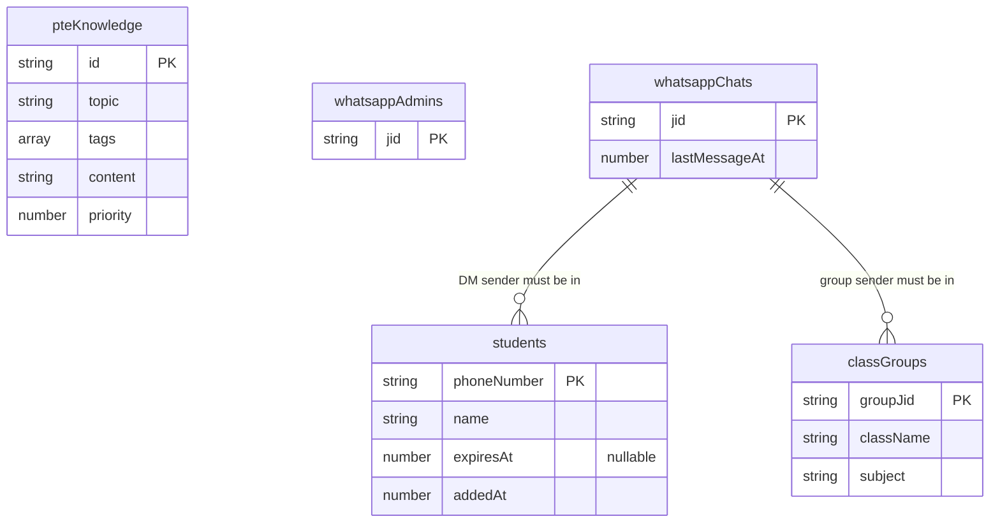
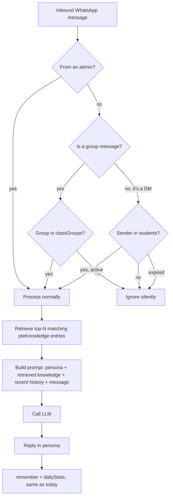

# LEO as a Real PTE Trainer — Architecture Plan

**Status: planning only — nothing in this doc is built yet.** Written to be
agreed on first, then implemented in phases (see §8).

## 1. What's actually being asked for

Four separate, real changes, bundled into one request:

1. **A real knowledge base** for PTE training content (not the small
   `companyKnowledge` facts collection that exists today) that LEO is
   "trained" on — built together, by hand, over time.
2. **Smart retrieval, not full-context stuffing.** Don't re-send the whole
   knowledge base on every message (slow, expensive, and doesn't scale past
   a small amount of content). Look up only what's relevant to *this*
   message, then answer from that.
3. **A real human persona.** LEO should talk like an actual adult PTE
   trainer — never "as an AI trainer, I...", never re-introducing itself,
   never breaking character. One consistent person with a name, a voice,
   opinions, and a teaching style.
4. **A closed classroom, not an open bot.** LEO only replies to:
   - Admins (already true today), always.
   - Individually-added students (by phone number), until an optional
     expiry date/time.
   - Anyone inside a WhatsApp group that's been marked as a class group.
   Everyone else — any other number, any other group — gets silence, not
   a reply, not an error message. Same as a real trainer not answering
   strangers.

## 2. Access control — "who does LEO even talk to"

This is the part with real security/privacy weight, so it's worth getting
precise before touching the knowledge/persona work.

### 2.1 New collection: `students`

Mirrors the existing `whatsappAdmins`/`dashboardAdmins` pattern exactly —
phone-number-keyed, developer (or whatsapp-admin?) managed from the
dashboard, live-watched in memory by the bridge, same as `adminJids` today.

```
students/{phoneDigits}
  phoneNumber: "94771234567"
  name: "Name the admin typed in"        // for the dashboard's own display
  addedAt: <server timestamp>
  addedBy: "<admin email or phone>"
  expiresAt: <epoch ms> | null           // null = no expiry
```

- Added one at a time from a new dashboard panel (mirrors
  `WhatsAppAdminsPanel`/`DashboardAdminsPanel`'s UI exactly — phone number +
  optional name + optional expiry date/time picker).
- `expiresAt` is just a field the bridge checks at message time
  (`Date.now() < expiresAt`) — no cron job needed to "remove" anyone;
  an expired student simply stops getting replies the moment their time is
  up, and still shows on the dashboard (greyed out / marked "expired") so
  nothing has to be manually cleaned up. Renewing = editing one field.

### 2.2 Groups: reusing `classGroups`, not a second collection

`classGroups` already exists and already means exactly this: *"a WhatsApp
group the developer has told LEO to treat as a class."* Today it only
gates essay/speaking scoring. Proposal: the same flag that makes a group a
class group *also* makes it a group LEO is allowed to chat in — if it's a
class, LEO is that class's trainer, full stop. No second "allowed groups"
collection to keep in sync with the first.

```
classGroups/{groupJid}
  className: "..."
  subject: "..."
  addedAt, addedBy        // already exist
```

(No new fields needed here — membership in this collection already *is*
the "this group can talk to LEO" signal.)

### 2.3 The gate itself

One function, checked once per inbound message, before any of the
existing dispatch logic runs:

```js
function isAuthorizedSender(senderJid, remoteJid, isGroup) {
  if (isWhatsAppAdmin(senderJid)) return true;       // admins: always
  if (isGroup) return isClassGroup(remoteJid);        // group: must be marked
  return isActiveStudent(senderJid);                  // DM: must be added + not expired
}
```

If this returns `false`, `processTurn` returns immediately — no LLM call,
no reply, no activity log entry. Exactly like a trainer not noticing a
stranger's message: not rude, just not happening.

**Open question for you (see §9):** inside an *authorized* class group,
should literally everyone in that group get replies (today's group
behavior — must say "Leo"), or should it be narrowed further to only
group members who are *also* individually in `students`? WhatsApp doesn't
expose "is this person actually in the group's member list to us
independent of them messaging," so in practice "message came from inside
a marked class group" is already a strong signal — I'd default to **group
membership is sufficient on its own**, since that's what "we mark the
group" means in your own wording. Flag if you want it stricter.

## 3. Knowledge base — structure and retrieval

### 3.1 The problem with "just read the whole database every message"

Three real costs if LEO's system prompt includes the *entire* PTE
knowledge base on every single message:
- **Token cost** scales with knowledge-base size × message volume — a
  growing knowledge base means a growing bill on every message, forever.
- **Latency** — bigger prompts are slower prompts.
- **Answer quality actually gets *worse*, not better**, past a certain
  size — this is a well-documented LLM failure mode ("lost in the
  middle"): the more unrelated content crammed into context, the more
  likely the model loses track of the one relevant fact in there.

The fix is retrieval: find the *small* number of knowledge entries
actually relevant to *this* message, and only send those.

### 3.2 Data model

New collection, `pteKnowledge` (separate from `companyKnowledge`, which
stays as-is for general company facts):

```
pteKnowledge/{id}
  topic: "writing.essay.structure"   // dotted category path, hand-chosen
  tags: ["essay", "structure", "4-paragraph"]   // keyword search surface
  question: "What's the right essay structure?"  // optional — if this
                                                   // entry answers a FAQ-
                                                   // shaped question directly
  content: "The full text you want LEO to know/say for this topic..."
  priority: 1-5                       // tie-break when multiple entries match
  addedBy, createdAt, updatedAt
```

You and I fill this in together, the same way `companyKnowledge` was
seeded — except this is the real, ongoing "training" work you mean: each
PTE topic (Read Aloud scoring quirks, Essay structure rules, common
mistakes per task type, example answers, your own teaching opinions and
phrasing) becomes one or more entries here, written once, reused forever.

### 3.3 Retrieval strategy — recommendation

Two realistic options, and I'd recommend starting with the cheaper one:

**Option A — Tag/keyword retrieval (recommended to start).**
Every incoming student message is matched against `tags`/`topic` by simple
keyword overlap (already-proven pattern in this codebase — the regex-based
command matching throughout `index.js` is exactly this kind of
deterministic matching, not ML). Pull the top N (e.g. 3-5) matching
entries by tag-overlap score, include only those in the prompt.
- **Pros:** zero extra cost, zero extra infra, easy to debug ("why did it
  pull this entry" is just "these tags matched"), ships fast.
- **Cons:** only as good as the tags you write; a badly-tagged entry is
  invisible to retrieval no matter how good its content is.

**Option B — Embedding-based semantic search.**
Each entry gets a vector embedding (one extra API call per entry, once,
at write time); each incoming message also gets embedded; Firestore's
vector search (`findNearest`, native since 2024) returns the closest
entries by meaning, not just keyword overlap — so "how do I not run out of
time in Read Aloud" matches an entry tagged `pacing` even with zero shared
words.
- **Pros:** much more forgiving of imperfect tagging; scales better as the
  knowledge base grows into the hundreds of entries.
- **Cons:** one more moving part (an embeddings API call per message, a
  vector index to maintain), small extra cost and latency per message,
  genuinely needed only once the knowledge base gets large/varied.

**My recommendation:** build Option A first. With a knowledge base you're
hand-writing entry by entry, it'll likely stay in the dozens-to-low-hundreds
range for a long while, where tag retrieval works great and costs nothing
extra. Swapping to Option B later is a self-contained upgrade (same
`pteKnowledge` collection, same retrieval-function call site in
`index.js`) — worth revisiting only if tag retrieval starts visibly
missing things once the content is bigger.

### 3.4 How a reply actually gets built

```
inbound message
      │
      ▼
isAuthorizedSender?  ──false──▶  (silently ignored)
      │ true
      ▼
retrieve top-N pteKnowledge entries matching this message
      │
      ▼
build prompt:
  [persona system prompt — fixed, same every time]
  + [retrieved knowledge entries — only the relevant few]
  + [recent conversation history — already how it works today]
  + [the message itself]
      │
      ▼
LLM call → reply, in-persona
      │
      ▼
remember() + recordMessageStat() + recordResponseTimeStat()  (all exist today)
```

The persona block is **small and fixed** — it costs the same every message
regardless of knowledge-base size, which is exactly the property you want.

## 4. The persona — a real trainer, not "an AI assistant"

Concretely, this means a rewritten system prompt (in `llmRouter.ts`,
alongside the existing `writingSystemPrompt`/scoring prompts) with rules
like:

- **A name, and a fixed backstory** — a few sentences establishing who
  "he" is as a PTE trainer (years of experience, teaching style, maybe a
  specific opinion or two that makes him feel like a real person rather
  than generic). You tell me what you want his name/background to
  actually be (see §9) — I'll turn it into the prompt, not invent an
  identity for you.
- **Never say what he is.** Explicit negative instructions: never say "as
  an AI", "as a trainer I...", "I'm here to help you with your PTE
  journey" robotic framing, never re-introduce himself mid-conversation,
  never apologize in a chatbot-ish way ("I apologize for any
  confusion caused"). Talk the way a slightly busy, experienced, friendly
  adult tutor actually texts — contractions, short sentences, occasional
  typos/casualness are *fine*, over-formality is the enemy here.
- **Teaching voice, not search-engine voice.** Give opinions ("honestly,
  most people overthink the essay conclusion"), ask the student things
  back sometimes, reference "last time we talked about X" using the real
  chat history that's already stored — all of this already works
  mechanically today (`remember()`/`ensureHistoryLoaded()`), it just needs
  the system prompt to actually lean into it instead of writing like
  documentation.
- This replaces/extends the *general chat* system prompt only — the
  existing scoring prompts (`writingSystemPrompt`, speaking rubrics) stay
  precise and rubric-literal, because scoring needs to be strict and
  reproducible, not personable. Persona is for conversation, not for the
  score itself.

## 5. Data model, end to end



## 6. Message flow, end to end



## 7. Dashboard changes this implies

- New **Students** panel (next to the existing WhatsApp Admins /
  Dashboard Admins panels under Users & Access) — add by phone number,
  optional name, optional expiry date/time, same list/remove UI pattern
  already built twice in this codebase.
- **Knowledge Base page gets an "add entry" form** — today's
  `KnowledgeBasePanel` is read-only (`companyKnowledge` only); this needs
  a real write UI for `pteKnowledge` (topic, tags, content, priority) so
  you can actually do the "build it together" part from the dashboard
  instead of editing Firestore by hand.
- **Class Groups panel gains a visible note** that marking a group here
  now also means "LEO chats here as trainer," not just "scoring is on" —
  since the meaning is being widened, worth being explicit about it in
  the UI copy so it's never a surprise.

## 8. Suggested build order

1. **Access gate first** (§2) — smallest, highest-value, most
   security-sensitive piece. Ships LEO-only-talks-to-the-right-people
   before anything about knowledge/persona even matters.
2. **Persona rewrite** (§4) — pure prompt-engineering, no new
   infrastructure, immediately changes how every conversation feels.
3. **Knowledge base + tag retrieval** (§3.2-§3.3, Option A) — new
   collection + dashboard write UI + one retrieval function.
4. **Students/Knowledge dashboard panels** (§7) — the UI to actually
   manage #1 and #3 day to day.
5. *(Later, only if needed)* Embedding-based retrieval upgrade (§3.3
   Option B).

## 9. What I need you to decide before I start building

- **Persona identity** — what should his name/background/voice actually
  be? (Keep "LEO" but as a person's name rather than an acronym? Years of
  experience, teaching style, any specific phrases/personality you want
  baked in?)
- **Unauthorized senders** — confirmed silence (no reply at all), or
  should a first-time unauthorized DM get exactly one polite
  "this number isn't registered for LEO, ask your trainer/admin to add
  you" message so people aren't left wondering why nothing happened?
- **Group access strictness** — as in §2.3: is "message came from inside
  a marked class group" enough on its own (my recommendation), or do you
  want it narrowed to only group members who are *also* individually
  added to `students`?
- **Expiry behavior** — when a student's time runs out, silent cutoff (my
  default assumption), or should LEO send one final "your access has
  expired, contact your trainer to renew" message at the moment it
  expires?
- **Who can manage `students`** — developer-only (matching
  `whatsappAdmins`/`dashboardAdmins` today), or should dashboard admins
  you've already added also be allowed to add/remove students day to day?
